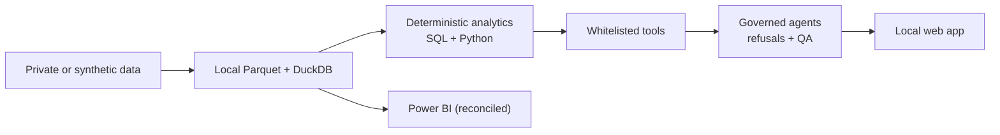

# Sidhartha Kandpal

**Pharma Commercial Intelligence · SCM Digitization · Data & AI**

MBA (Pharmaceutical Management). I build analytics and AI tools for pharmaceutical commercial and supply-chain work. The numbers come from tested, deterministic code, and AI is used to route, explain and refuse, not to invent figures.

---

### Current focus
- **Commercial intelligence:** market, brand and portfolio analytics on secondary-sales audit data (MAT / YTD / monthly windows, share, evolution index, growth contribution).
- **Governed agentic AI:** agents that call whitelisted, tested tools, with refusals and QA checks for what the data cannot support.
- **Supply-chain digitization:** procurement and material-master workflows built on enterprise master data.

### Technical stack
- **Core:** Python · SQL (DuckDB) · Power BI (DAX, TMDL/PBIR) · Agentic AI (tool-grounded orchestration)
- **Also used:** TypeScript / React · pyarrow / Parquet · pytest · Docker · Git · Gemini API (routing only)

---

### Flagship project

#### [pharma-commercial-intelligence](https://github.com/SiDjr18/pharma-commercial-intelligence)
**Pharma Commercial Intelligence & Brand Growth Engine.** A local-first commercial-analytics product for pharmaceutical secondary-sales data. It was built on a licensed national audit that is **not** published; the public version runs on a fictional, structure-only synthetic dataset.

| Capability | How |
|---|---|
| Deterministic analytics | SQL engine plus an independent pure-Python engine, cross-checked field by field |
| Opportunity scoring | Explainable percentile score (market growth, relative momentum, market position); descriptive, not a forecast |
| Scenario analysis | Price/volume, market-growth and share what-ifs on an observed baseline; invalid assumptions are rejected, never corrected |
| Governed agentic AI | Orchestrator plus 6 specialist agents that use 15 whitelisted tools; deterministic refusals and a QA gate that withholds unverifiable answers |
| Power BI | Generated semantic model and report, reconciled against the SQL and Python engines |
| Public-safe data | Synthetic dataset, leakage tests and publication guards; 886 automated tests |

### Selected projects
| Project | Summary |
|---|---|
| [marketlens-iq](https://github.com/SiDjr18/marketlens-iq) | Browser-based pharma market dashboard: maps IMS/IQVIA-style datasets (Excel/CSV/SQL/JSON) to pharma fields, gates insights behind data-health checks, exports CSV/PDF/PPT/PNG. *TypeScript* |
| [vynq](https://github.com/SiDjr18/vynq) | CDMO/pharma procurement workflow platform: material-master lookup, vendor recommendations, RFQ/PO/contract creation on generated demo data. *TypeScript · Prisma · Docker* |
| [customer-retention-ai-agent](https://github.com/SiDjr18/customer-retention-ai-agent) | Churn decision-intelligence app: churn prediction, revenue at risk, next-best actions and a question-answering agent. *Python · React* |

---

### Currently learning
- Cloud fundamentals (AWS)
- Evaluating LLM function-calling against deterministic tool contracts

### Contact
Reach me through [GitHub](https://github.com/SiDjr18).

Public repositories contain synthetic or generated demo data only.
